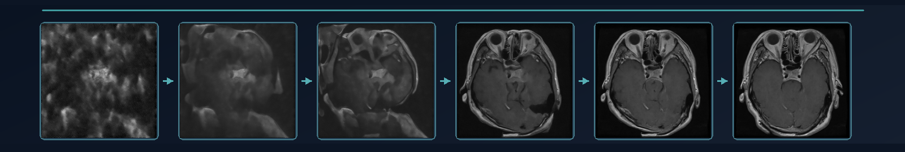
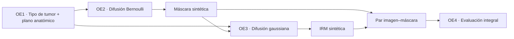
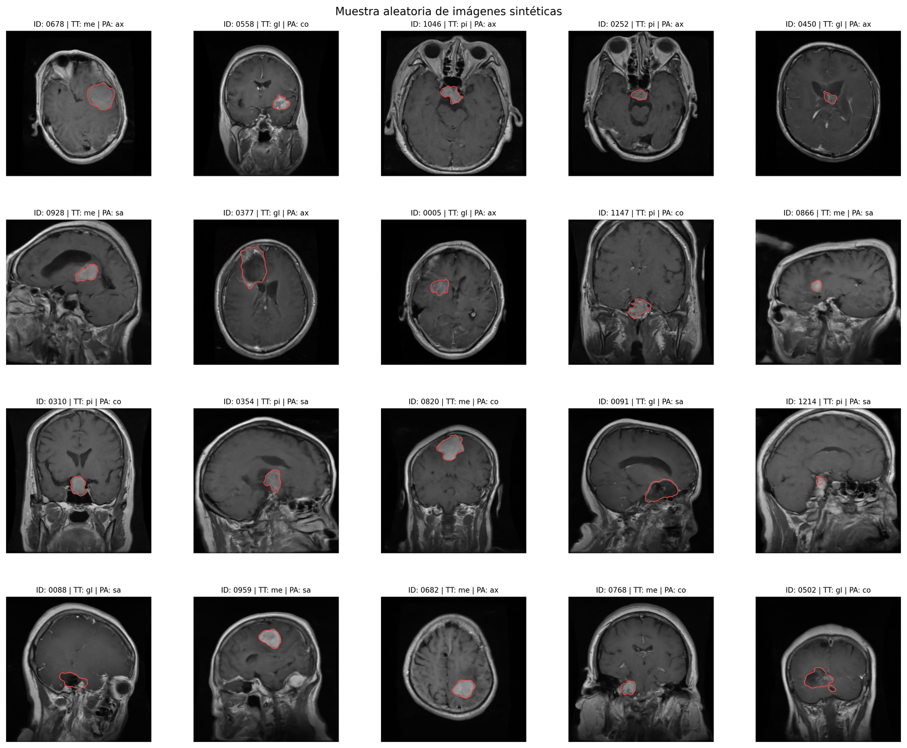

<h1 align="center">Síntesis de imágenes de resonancia magnética cerebral mediante modelos de difusión condicionados</h1>

<p align="center">
  
</p><p align="center">
  


  
## Descripción del proyecto

Este repositorio reúne el código, los procedimientos experimentales y los resultados del proyecto de título «Síntesis de imágenes de resonancia magnética cerebral mediante modelos de difusión condicionados», desarrollado en el marco de la carrera de Ingeniería en Estadística y Ciencia de Datos de la Universidad de Valparaíso, Chile, para optar al título profesional de Ingeniero en Estadística y Ciencia de Datos.

El proyecto estudia la generación de pares sintéticos compuestos por una imagen de resonancia magnética (IRM) cerebral y su máscara de segmentación tumoral, mediante una arquitectura generativa en cascada de dos modelos de difusión condicionados.

La investigación utiliza el conjunto de datos BRISC2025 y considera tres tipos de tumor —glioma, meningioma e hipófisis/pituitario— y tres planos anatómicos —axial, coronal y sagital—. El proceso incluye caracterización distribucional de los datos, generación de máscaras, síntesis de imágenes y evaluación integral de los pares resultantes.

## Arquitectura generativa

La propuesta implementa una **cascada de dos etapas**: primero se genera una máscara tumoral condicionada por tipo de tumor y plano anatómico; posteriormente se genera una imagen de IRM condicionada por esa máscara y por las mismas variables categóricas.



El primer modelo está orientado a la generación de máscaras binarias; el segundo, a la generación de imágenes en escala de grises. Para la síntesis de imágenes se utiliza muestreo DDIM.

### Objetivos del proyecto

| Etapa                             | Propósito                                                       | Contenido principal                                                                                           |
| --------------------------------- | --------------------------------------------------------------- | ------------------------------------------------------------------------------------------------------------- |
| **OE0 · Preparación auxiliar**    | Depurar y examinar los datos.                                   | Detección de duplicados, controles de calidad y procedimientos auxiliares.                                    |
| **OE1 · Análisis distribucional** | Caracterizar las intensidades de las IRM según las condiciones. | Análisis global, tumoral y no tumoral por tipo de tumor y plano.                                              |
| **OE2 · Difusión Bernoulli**      | Generar máscaras tumorales sintéticas.                          | Modelo condicionado por tipo de tumor y plano anatómico.                                                      |
| **OE3 · Difusión gaussiana**      | Generar imágenes de IRM sintéticas.                             | Modelo condicionado por máscara tumoral, transformada de la máscara tumoral, tipo de tumor y plano anatómico. |
| **OE4 · Evaluación integral**     | Evaluar la calidad, coherencia y fidelidad de los pares.        | Comparaciones con imágenes reales, análisis de coherencia imagen–máscara y consistencia condicional.          |

## Galería de pares sintéticos

La colección final contiene 1.260 pares imagen–máscara, distribuidos de forma equilibrada entre las nueve combinaciones de tipo de tumor y plano anatómico (140 pares por condición).

<p align="center">
  
</p>

<p align="center"><em>Muestra de imágenes sintéticas generadas. El contorno rojo representa la máscara tumoral generada correspondiente a cada imagen.</em></p>

Los archivos finales se organizan en [`synthetic-pairs/`](../synthetic-pairs/):

```text
synthetic-pairs/
├── images/
│   ├── synt2026_00001_gl_ax.png
│   └── ...
└── masks/
    ├── synt2026_00001_gl_ax.png
    └── ...
```

La nomenclatura `synt2026_XXXXX_tt_pp` identifica el par por un ID global consecutivo, el tipo tumoral (`gl`, `me`, `pi`) y el plano anatómico (`ax`, `co`, `sa`). La imagen y su máscara comparten el mismo nombre base.

## Organización del repositorio

```text
.
├── docs/                  # Documentación y recursos visuales
│   ├── README.md          # Descripción general del proyecto
│   ├── ENVIRONMENT.md     # Entorno computacional utilizado
│   └── requirements.txt   # Dependencias de Python
├── data/                  # Instrucciones de acceso y preparación de BRISC2025
├── notebooks/
│   ├── OE0/               # Depuración y procedimientos auxiliares
│   ├── OE1/               # Análisis distribucional
│   ├── OE2/               # Difusión Bernoulli: máscaras
│   ├── OE3/               # Difusión gaussiana: IRM
│   └── OE4/               # Evaluación de pares sintéticos
├── results/               # Resultados experimentales
└── synthetic-pairs/       # Conjunto final de 1260 pares imagen–máscara
```

## Datos y reproducibilidad

El proyecto utiliza el conjunto BRISC2025, descrito en:

Fateh, A., Rezvani, Y., Moayedi, S. et al. (2026). *BRISC: Annotated Dataset for Brain Tumor Segmentation and Classification*. Scientific Data, 13, 361.

* [Artículo científico (DOI)](https://doi.org/10.1038/s41597-026-06753-y)
* [Conjunto de datos BRISC2025](https://www.kaggle.com/datasets/briscdataset/brisc2025/)

Los datos reales de BRISC2025 no se redistribuyen en este repositorio. Las instrucciones para obtenerlos, organizarlos y aplicar la depuración se encuentran en [`data/README.md`](data/README.md).

Después del procedimiento de depuración, el diseño experimental contempla 3.792 pares de entrenamiento, 420 de validación y 420 de prueba final. 

## Información académica

**Proyecto de título:** Síntesis de imágenes de resonancia magnética cerebral mediante modelos de difusión condicionados  
**Carrera:** Ingeniería en Estadística y Ciencia de Datos  
**Institución:** Universidad de Valparaíso, Chile  
**Año:** 2026

---
